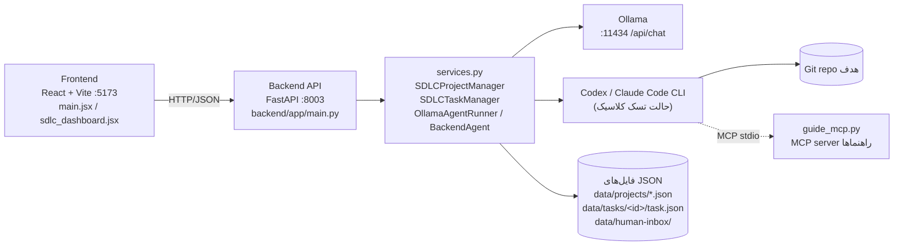
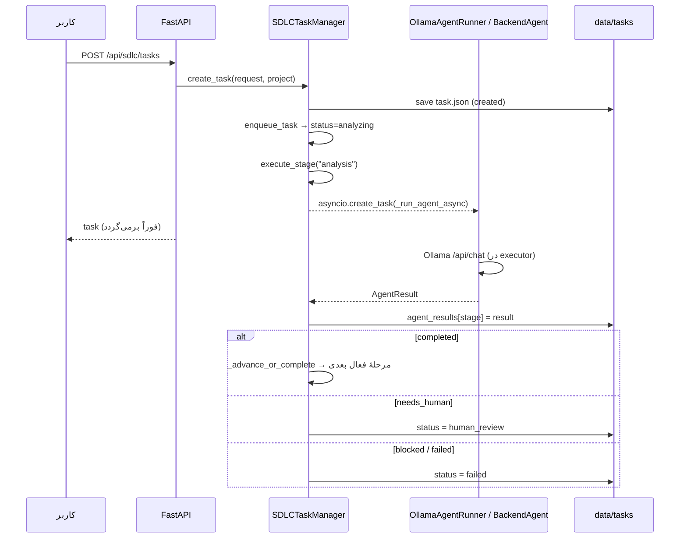
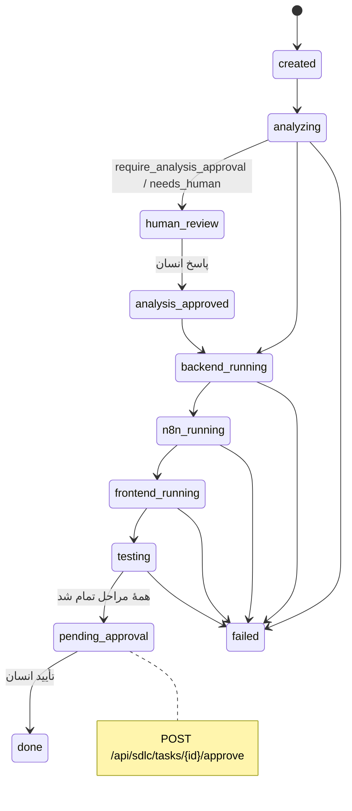

# معماری Taskloom

## نمای کلی

سیستم دو حالت دارد که در یک کد کنار هم زندگی می‌کنند:

1. **حالت تسک کلاسیک** (`TaskState`, `execute_task`, `continue_task`): یک عامل CLI (Codex یا Claude Code)
   روی برنچ `tasks/<id>` در repo هدف کار می‌کند، تست‌ها اجرا می‌شوند و کاربر commit/push/MR را انجام می‌دهد.
   UI آن در `frontend/src/main.jsx` است.
2. **حالت SDLC** (`SDLCTask`, `SDLCTaskManager`): یک خط لولهٔ چندمرحله‌ای با عامل‌های Ollama.
   UI آن در `frontend/src/sdlc_dashboard.jsx` است.

## ماژول‌ها

| فایل | مسئولیت |
|---|---|
| `main.py` (ریشه) | نقطهٔ ورود: `python main.py [--port 8003] [--no-browser] [--data-dir]`؛ UI build‌شده را هم سرو می‌کند |
| `backend/app/main.py` | تعریف FastAPI app، CORS و routeها |
| `backend/app/models.py` | مدل‌های Pydantic: `TaskState`, `SDLCTask`, `SDLCProjectConfig`, `AgentResult`, `HumanIntervention`, ... |
| `backend/app/services.py` | منطق اصلی: اجرای CLI عامل، git، workspace، event streamها، مدیریت پروژه/تسک SDLC، فراخوانی Ollama |
| `backend/app/guide_mcp.py` | یک MCP server روی stdio که فایل‌های Markdown راهنما را به عامل ارائه می‌دهد |
| `backend/app/config.py` | تنظیمات از متغیرهای محیطی: `OLLAMA_BASE_URL`، `OLLAMA_MODEL` (پیش‌فرض `qwen3.5:0.8b`) |
| `frontend/src/main.jsx` | UI تسک کلاسیک + workspace explorer |
| `frontend/src/sdlc_dashboard.jsx` | داشبورد کانبان SDLC، پروژه‌ها، inbox انسانی، GitHub |

## جریان SDLC

### ماشین وضعیت (`SDLCStatus`)

`revision`, `human_qa`, `blocked` در enum هستند ولی هیچ مسیری در کد به آن‌ها نمی‌رسد.

مراحل از `project.workflow.stages` خوانده می‌شوند و عامل‌هایی که `enabled=false` دارند رد می‌شوند.

### عامل‌ها

| مرحله | پیاده‌سازی | خروجی واقعی |
|---|---|---|
| analysis | `OllamaAgentRunner.run_analysis` | JSON از LLM؛ اگر Ollama در دسترس نباشد یک نتیجهٔ **ساختگی** «completed» برمی‌گردد |
| backend | `BackendAgent.generate_code` | **قالب ثابت** (FastAPI/Dockerfile/README) در `<project_path>/backend` نوشته می‌شود؛ LLM صدا زده نمی‌شود و نتایج تست hard-code شده‌اند |
| n8n / frontend / qa | `OllamaAgentRunner.run_agent` | فقط گزارش JSON؛ هیچ فایلی نوشته نمی‌شود و تستی اجرا نمی‌شود |

## ذخیره‌سازی

همه‌چیز فایل JSON است، بدون دیتابیس و بدون قفل:

- `data/projects/<project_id>.json` — `SDLCProjectConfig`
- `data/tasks/<task_id>/task.json` — `SDLCTask` (نوشتن اتمیک با فایل `.tmp` و `replace`)
- `data/human-inbox/pending|resolved/<INT-id>.json` — `HumanIntervention`
- `~/.taskloom/role-knowledge.json` — مسیرهای دانش نقش‌ها (حالت کلاسیک)

مسیرها نسبی هستند (`Path("data/...")`)، پس محل ذخیره به **پوشهٔ جاری هنگام اجرای سرور** بستگی دارد —
به همین دلیل `backend/data/` جدا از `data/` به وجود آمده است.
