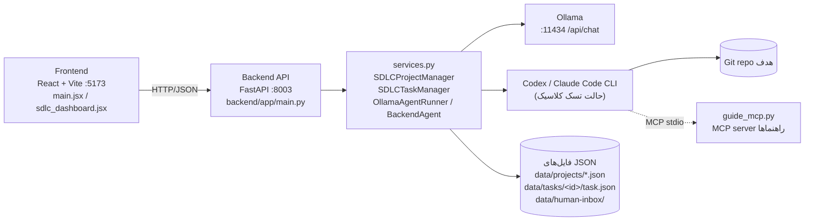
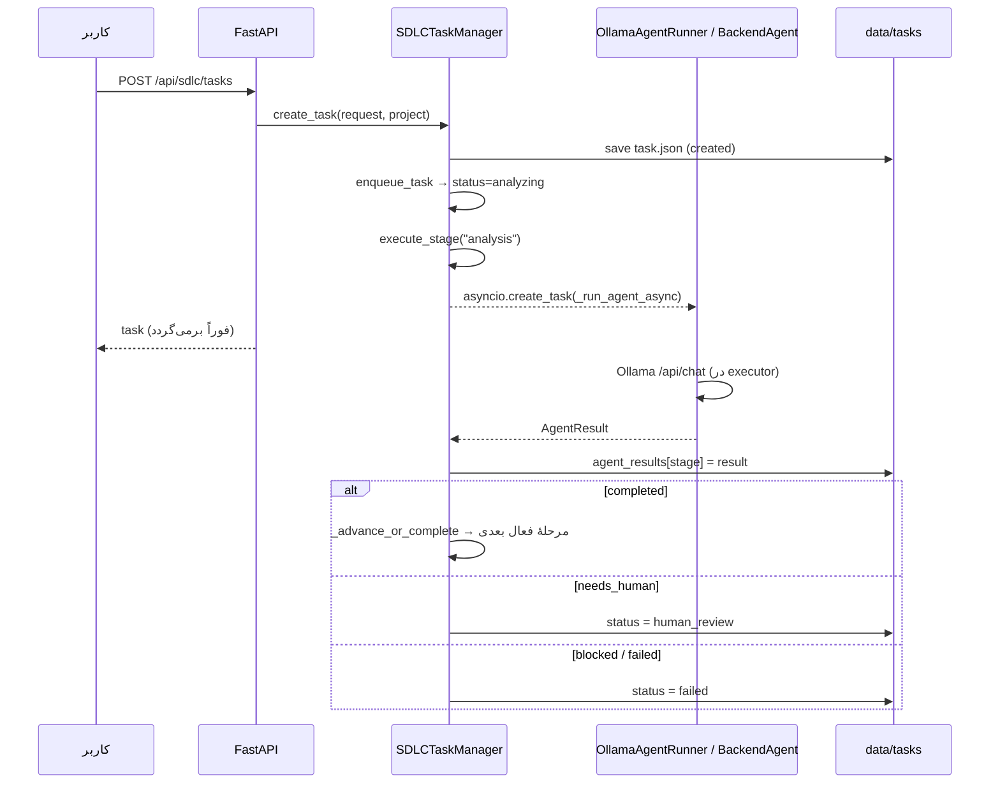
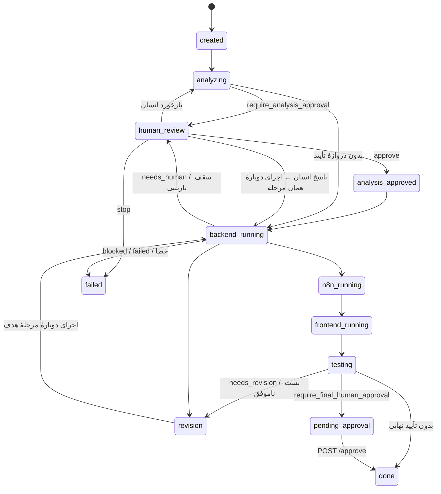
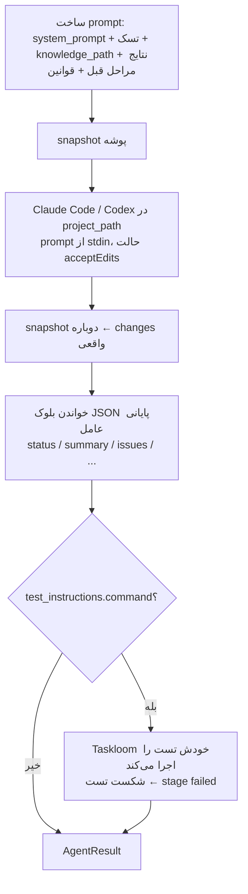

# معماری Taskloom

## نمای کلی

سیستم دو حالت دارد که در یک کد کنار هم زندگی می‌کنند:

1. **حالت تسک کلاسیک** (`TaskState`, `execute_task`, `continue_task`): یک عامل CLI (Codex یا Claude Code)
   روی برنچ `tasks/<id>` در repo هدف کار می‌کند، تست‌ها اجرا می‌شوند و کاربر commit/push/MR را انجام می‌دهد.
   UI آن در `frontend/src/main.jsx` است.
2. **حالت SDLC** (`SDLCTask`, `SDLCTaskManager`): یک خط لولهٔ چندمرحله‌ای با عامل‌های Ollama.
   UI آن در `frontend/src/sdlc_dashboard.jsx` است.

## ماژول‌ها

| فایل | مسئولیت |
|---|---|
| `main.py` (ریشه) | نقطهٔ ورود: `python main.py [--port 8003] [--no-browser] [--data-dir]`؛ UI build‌شده را هم سرو می‌کند |
| `backend/app/main.py` | تعریف FastAPI app، CORS و routeها |
| `backend/app/models.py` | مدل‌های Pydantic: `TaskState`, `SDLCTask`, `SDLCProjectConfig`, `AgentResult`, `HumanIntervention`, ... |
| `backend/app/services.py` | منطق اصلی: اجرای CLI عامل، git، workspace، event streamها، مدیریت پروژه/تسک SDLC، فراخوانی Ollama |
| `backend/app/guide_mcp.py` | یک MCP server روی stdio که فایل‌های Markdown راهنما را به عامل ارائه می‌دهد |
| `backend/app/config.py` | تنظیمات از متغیرهای محیطی: `OLLAMA_BASE_URL`، `OLLAMA_MODEL` (پیش‌فرض `qwen3.5:0.8b`) |
| `frontend/src/main.jsx` | UI تسک کلاسیک + workspace explorer |
| `frontend/src/sdlc_dashboard.jsx` | داشبورد کانبان SDLC، پروژه‌ها، inbox انسانی، GitHub |

## جریان SDLC

### ماشین وضعیت (`SDLCStatus`)

(برای خوانایی، یال‌های `revision` و `human_review` فقط برای backend رسم شده‌اند؛ برای همهٔ مراحل یکسان است.)

### صندوق انسانی (human inbox)

هر مورد در `data/human-inbox/pending/` یک `kind` در `context` دارد و پاسخ انسان (`SDLCTaskManager.submit_human_response`) این‌طور عمل می‌کند:

| `kind` | چه زمانی | `approve` | متن آزاد | `stop` |
|---|---|---|---|---|
| `analysis_approval` | پایان analysis وقتی `require_analysis_approval` | رفتن به مرحلهٔ بعد | analysis با بازخورد دوباره اجرا می‌شود | `failed` |
| `agent_question` | عامل `needs_human` برگرداند | — | همان مرحله با پاسخ دوباره اجرا می‌شود | `failed` |
| `revision_limit` | `revision_count` به `max_revision_attempts` رسید یا مرحلهٔ هدف نامعتبر بود | — | مرحلهٔ درخواست‌کننده با راهنمایی دوباره اجرا می‌شود | `failed` |
| `interrupted` | سرور وسط اجرای مرحله بسته شد | `resume`: مرحله دوباره اجرا می‌شود | مرحله با راهنمایی دوباره اجرا می‌شود | `failed` |

پاسخ‌های انسان و درخواست‌های بازبینی هر مرحله در prompt اجرای بعدی همان مرحله قرار می‌گیرند (`sdlc_runner.stage_feedback`) — هم برای عامل CLI و هم Ollama.

### حلقهٔ بازبینی

- عامل با `needs_revision` و `revision_target` مرحلهٔ دیگری را برمی‌گرداند؛ شکست تست‌های یک مرحله هم یعنی `needs_revision` به خود همان مرحله (با خروجی تست).
- تا `max_revision_attempts` بار (برای کل تسک) خط لوله از مرحلهٔ هدف دوباره جلو می‌رود؛ بعد از آن از انسان پرسیده می‌شود.
- خروجی زندهٔ عامل در حال اجرا در حافظه نگه داشته می‌شود و `GET /api/sdlc/tasks/{id}` آن را در `base_task.live_output` برمی‌گرداند؛ داشبورد آن را در جزئیات تسک نشان می‌دهد.

مراحل از `project.workflow.stages` خوانده می‌شوند و عامل‌هایی که `enabled=false` دارند رد می‌شوند.

### عامل‌ها (اجراکنندهٔ هر مرحله)

هر مرحله با فیلد `runner` در `AgentConfig` اجرا می‌شود (`backend/app/sdlc_runner.py`):

| `runner` | رفتار |
|---|---|
| `auto` (پیش‌فرض) | اگر مرحله `project_path` دارد و Claude Code (یا Codex) نصب است ← عامل CLI؛ وگرنه Ollama |
| `claude` / `codex` | عامل CLI واقعی در پوشهٔ `project_path` |
| `ollama` | فقط گزارش متنی؛ فایلی نوشته نمی‌شود. فایل‌هایی که مدل «پیشنهاد» می‌دهد در `recommendations.proposed_changes` ثبت می‌شوند، نه در `changes` |

اجرای یک مرحله با عامل CLI:

- مراحل `analysis` و `qa` فقط گزارش می‌دهند؛ `backend`، `n8n` و `frontend` کد می‌نویسند.
- `changes` را Taskloom از روی دیسک تعیین می‌کند، نه از ادعای مدل.
- وضعیت‌های عامل: `completed` ← مرحلهٔ بعد؛ `needs_human` ← یک HumanIntervention در inbox و `human_review`؛
  `needs_revision` ← حلقهٔ بازبینی (پایین‌تر)؛ `blocked`/`failed` ← `failed` با دلیل.
- تنظیمات هر مرحله: `project_path`، `knowledge_path`، `system_prompt`، `test_instructions: {"command": "...", "working_directory": "..."}`،
  `cli_timeout_seconds` (پیش‌فرض 3600) و `timeout_seconds` (فقط Ollama).

### بازیابی پس از restart

- هنگام اجرای عامل CLI، PID و نام برنامهٔ آن در `data/tasks/<id>/agent.pid` نوشته می‌شود و پس از پایان حذف می‌شود.
- در شروع سرور (`lifespan` ← `SDLCTaskManager.recover_interrupted_tasks`) هر تسکی که در وضعیت در حال اجرا مانده باشد پیدا می‌شود:
  - اگر فرایند عامل قبلی هنوز زنده باشد و **همان برنامه** باشد (نام برنامه با مقدار ثبت‌شده مقایسه می‌شود تا PID بازاستفاده‌شده کشته نشود)، کل درخت فرایند آن متوقف می‌شود.
    روی ویندوز عامل با crash سرور نمی‌میرد و به ویرایش فایل‌ها ادامه می‌دهد؛ بدون این کار دو عامل هم‌زمان در یک پوشه کار می‌کردند.
  - یک مورد `interrupted` در inbox ساخته می‌شود: `resume` همان مرحله را دوباره اجرا می‌کند، `stop` تسک را متوقف می‌کند.
  - اگر `workflow.auto_resume_interrupted` روشن باشد، مرحله بدون پرسیدن دوباره اجرا می‌شود.
- خاموش‌کردن عادی سرور (Ctrl+C) اجرای عامل را لغو و فرایند را می‌کشد؛ این مسیر فقط برای crash یا kill است.

### Git و GitHub (`backend/app/sdlc_git.py`)

- اگر پوشهٔ یک مرحله داخل یک repository گیت باشد، قبل از اجرای عامل آن repo روی برنچ `sdlc/<task-id>` می‌رود؛
  برنچ یک بار از `github_config.branch` (پیش‌فرض `main`، یا برنچ فعلی اگر وجود نداشته باشد) ساخته می‌شود و مراحل بعدی همان تسک روی آن ادامه می‌دهند.
- اگر repo روی برنچ دیگری تغییرات commit‌نشده داشته باشد، مرحله با پیام روشن `failed` می‌شود تا کار دو تسک قاطی نشود.
- برای هر repo یک `TaskRepo` در `task.repos` ثبت می‌شود: برنچ، برنچ پایه، آخرین commit، push شده یا نه، و لینک PR.
- commit، push و PR فقط با دکمه‌های داشبورد (اقدام انسانی) انجام می‌شوند:

| Endpoint | کار |
|---|---|
| `POST .../github/validate` | بررسی دسترسی token به repo از طریق GitHub API |
| `POST .../github/commit-push` | `git add -A` و commit روی برنچ تسک (پیام شامل خلاصهٔ مراحل)، سپس push همان برنچ |
| `POST .../github/create-pr` | ساخت PR از `sdlc/<task-id>` به برنچ پایه با خلاصه، فایل‌ها، نتیجهٔ تست‌ها و issueهای هر مرحله؛ اگر PR وجود داشته باشد همان را برمی‌گرداند |

- token در هر درخواست فرستاده می‌شود (یا از `github_config` / `GITHUB_TOKEN`)، در remote گیت ذخیره نمی‌شود و در پیام خطا با `***` پوشانده می‌شود.
- آدرس غیر GitHub (مثلاً یک remote محلی) برای push پذیرفته می‌شود ولی ساخت PR فقط برای GitHub است.

## ذخیره‌سازی

همه‌چیز فایل JSON است، بدون دیتابیس و بدون قفل:

- `data/projects/<project_id>.json` — `SDLCProjectConfig`
- `data/tasks/<task_id>/task.json` — `SDLCTask` (نوشتن اتمیک با فایل `.tmp` و `replace`)
- `data/human-inbox/pending|resolved/<INT-id>.json` — `HumanIntervention`
- `~/.taskloom/role-knowledge.json` — مسیرهای دانش نقش‌ها (حالت کلاسیک)

مسیرها نسبی هستند (`Path("data/...")`)، پس محل ذخیره به **پوشهٔ جاری هنگام اجرای سرور** بستگی دارد —
به همین دلیل `backend/data/` جدا از `data/` به وجود آمده است.
