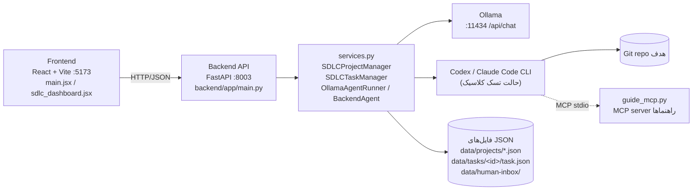
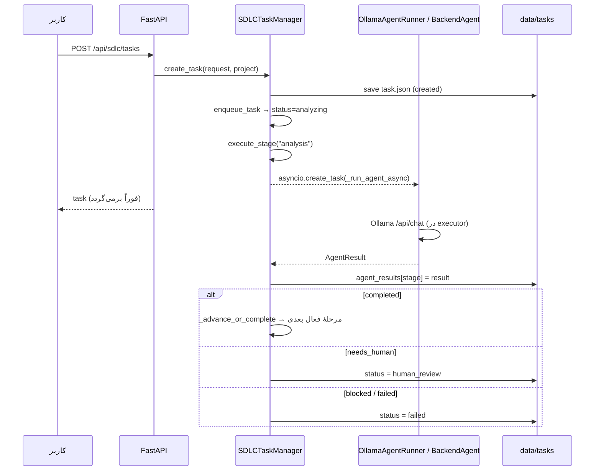
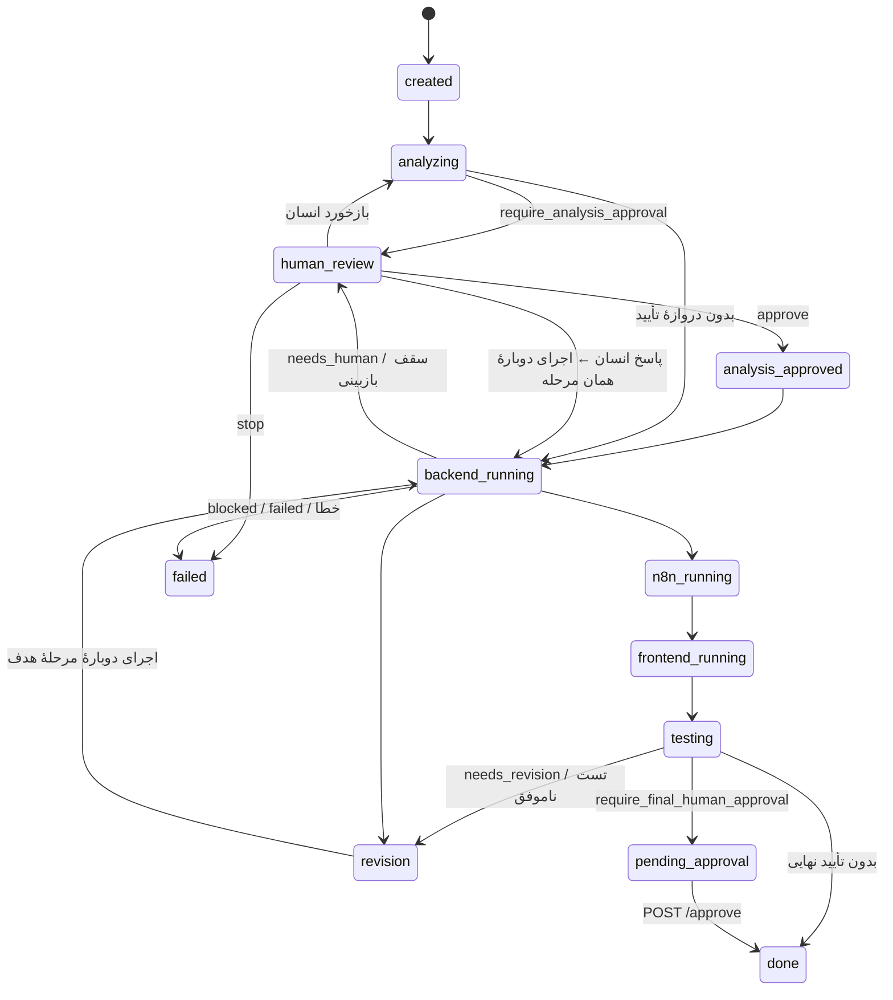
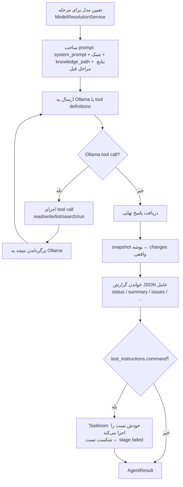
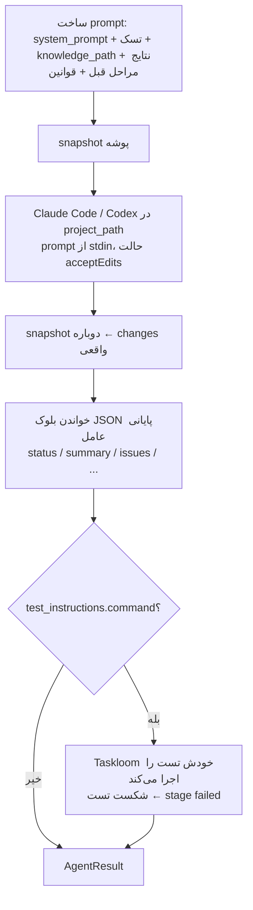
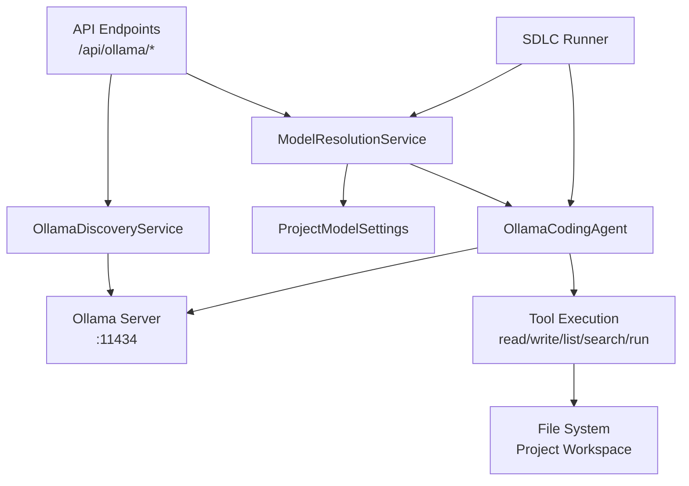
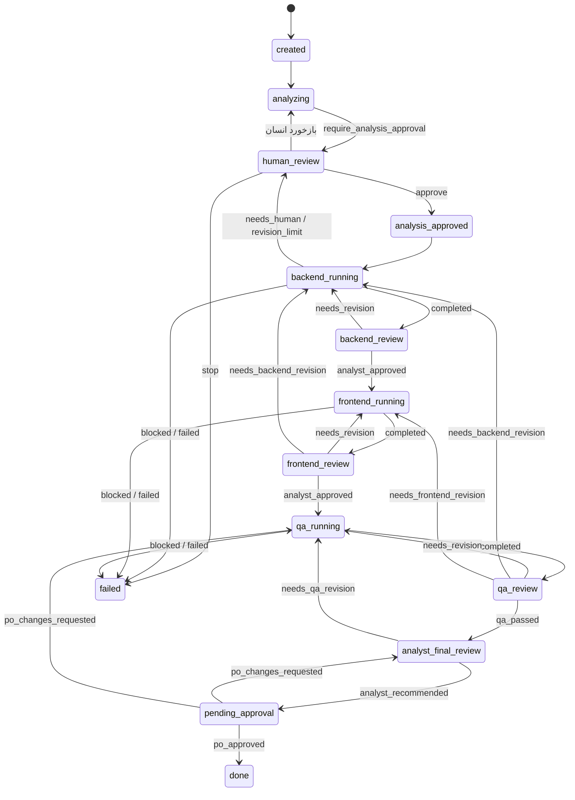

# معماری Taskloom

## نمای کلی



سیستم دو حالت دارد که در یک کد کنار هم زندگی می‌کنند:

1. **حالت تسک کلاسیک** (`TaskState`, `execute_task`, `continue_task`): یک عامل CLI (Codex یا Claude Code)
   روی برنچ `tasks/<id>` در repo هدف کار می‌کند، تست‌ها اجرا می‌شوند و کاربر commit/push/MR را انجام می‌دهد.
   UI آن در `frontend/src/main.jsx` است.
2. **حالت SDLC** (`SDLCTask`, `SDLCTaskManager`): یک خط لولهٔ چندمرحله‌ای با عامل‌های Ollama.
   UI آن در `frontend/src/sdlc_dashboard.jsx` است.

## ماژول‌ها

| فایل | مسئولیت |
|---|---|
| `main.py` (ریشه) | نقطهٔ ورود: `python main.py [--port 8003] [--no-browser] [--data-dir]`؛ UI build‌شده را هم سرو می‌کند |
| `backend/app/main.py` | تعریف FastAPI app، CORS و routeها |
| `backend/app/models.py` | مدل‌های Pydantic: `TaskState`, `SDLCTask`, `SDLCProjectConfig`, `AgentResult`, `HumanIntervention`, `ModelInfo`, `ProjectModelSettings`, ... |
| `backend/app/services.py` | منطق اصلی: اجرای CLI عامل، git، workspace، event streamها، مدیریت پروژه/تسک SDLC، فراخوانی Ollama |
| `backend/app/sdlc_runner.py` | اجراکننده مراحل SDLC، انتخاب runner مناسب، snapshot فایل‌ها |
| `backend/app/guide_mcp.py` | یک MCP server روی stdio که فایل‌های Markdown راهنما را به عامل ارائه می‌دهد |
| `backend/app/config.py` | تنظیمات از متغیرهای محیطی: `OLLAMA_BASE_URL`، `OLLAMA_MODEL` (پیش‌فرض `qwen3.5:0.8b`) |
| `frontend/src/main.jsx` | UI تسک کلاسیک + workspace explorer |
| `frontend/src/sdlc_dashboard.jsx` | داشبورد کانبان SDLC، پروژه‌ها، inbox انسانی، GitHub |
| `frontend/src/model_settings.jsx` | تنظیمات مدل‌های AI برای هر پروژه |

## جریان SDLC



### ماشین وضعیت (`SDLCStatus`)



(برای خوانایی، یال‌های `revision` و `human_review` فقط برای backend رسم شده‌اند؛ برای همهٔ مراحل یکسان است.)

### صندوق انسانی (human inbox)

هر مورد در `data/human-inbox/pending/` یک `kind` در `context` دارد و پاسخ انسان (`SDLCTaskManager.submit_human_response`) این‌طور عمل می‌کند:

| `kind` | چه زمانی | `approve` | متن آزاد | `stop` |
|---|---|---|---|---|
| `analysis_approval` | پایان analysis وقتی `require_analysis_approval` | رفتن به مرحلهٔ بعد | analysis با بازخورد دوباره اجرا می‌شود | `failed` |
| `agent_question` | عامل `needs_human` برگرداند | — | همان مرحله با پاسخ دوباره اجرا می‌شود | `failed` |
| `revision_limit` | `revision_count` به `max_revision_attempts` رسید یا مرحلهٔ هدف نامعتبر بود | — | مرحلهٔ درخواست‌کننده با راهنمایی دوباره اجرا می‌شود | `failed` |
| `interrupted` | سرور وسط اجرای مرحله بسته شد | `resume`: مرحله دوباره اجرا می‌شود | مرحله با راهنمایی دوباره اجرا می‌شود | `failed` |

پاسخ‌های انسان و درخواست‌های بازبینی هر مرحله در prompt اجرای بعدی همان مرحله قرار می‌گیرند (`sdlc_runner.stage_feedback`) — هم برای عامل CLI و هم Ollama.

### حلقهٔ بازبینی

- عامل با `needs_revision` و `revision_target` مرحلهٔ دیگری را برمی‌گرداند؛ شکست تست‌های یک مرحله هم یعنی `needs_revision` به خود همان مرحله (با خروجی تست).
- تا `max_revision_attempts` بار (برای کل تسک) خط لوله از مرحلهٔ هدف دوباره جلو می‌رود؛ بعد از آن از انسان پرسیده می‌شود.
- خروجی زندهٔ عامل در حال اجرا در حافظه نگه داشته می‌شود و `GET /api/sdlc/tasks/{id}` آن را در `base_task.live_output` برمی‌گرداند؛ داشبورد آن را در جزئیات تسک نشان می‌دهد.

مراحل از `project.workflow.stages` خوانده می‌شوند و عامل‌هایی که `enabled=false` دارند رد می‌شوند.

### عامل‌ها (اجراکنندهٔ هر مرحله)

هر مرحله با فیلد `runner` در `AgentConfig` اجرا می‌شود (`backend/app/sdlc_runner.py`):

| `runner` | رفتار |
|---|---|
| `auto` (پیش‌فرض) | اول Ollama اگر در دسترس باشد، سپس اگر مرحله `project_path` دارد و Claude Code (یا Codex) نصب است ← عامل CLI |
| `claude` / `codex` | عامل CLI واقعی در پوشهٔ `project_path` |
| `ollama` | **OllamaCodingAgent** با tool calling کامل برای ویرایش فایل‌ها |

#### OllamaCodingAgent (سیستم چند-مدلی جدید)

TaskLoom اکنون از Ollama به عنوان عامل کدنویسی پیش‌فرض با قابلیت‌های زیر پشتیبانی می‌کند:

1. **کشف پویا مدل‌ها**: دریافت خودکار مدل‌های نصب شده Ollama از `/api/tags`
2. **پیکربندی پروژه**: هر پروژه می‌تواند مدل پیش‌فرض و تخصیص مدل برای هر مرحله را تنظیم کند
3. **Tool Calling**: پشتیبانی از ابزارهای زیر برای ویرایش واقعی فایل‌ها:
   - `read_file`: خواندن محتوای فایل
   - `list_files`: لیست فایل‌های پروژه
   - `write_file`: ایجاد یا ویرایش فایل
   - `delete_file`: حذف فایل
   - `search_files`: جستجوی متن در فایل‌ها
   - `run_command`: اجرای دستورات امن (npm, python, git read-only, etc.)
4. **امنیت**: validation کامل مسیرها، جلوگیری از path traversal، محدودیت دستورات
5. **مدیریت مدل**: اولویت‌بندی انتخاب مدل: task override → stage assignment → project default → environment → fallback

#### اجرای یک مرحله با OllamaCodingAgent:



اجرای یک مرحله با عامل CLI:



- مراحل `analysis` و `qa` فقط گزارش می‌دهند؛ `backend`، `n8n` و `frontend` کد می‌نویسند.
- `changes` را Taskloom از روی دیسک تعیین می‌کند، نه از ادعای مدل.
- وضعیت‌های عامل: `completed` ← مرحلهٔ بعد؛ `needs_human` ← یک HumanIntervention در inbox و `human_review`؛
  `needs_revision` ← حلقهٔ بازبینی (پایین‌تر)؛ `blocked`/`failed` ← `failed` با دلیل.
- تنظیمات هر مرحله: `project_path`، `knowledge_path`، `system_prompt`، `test_instructions: {"command": "...", "working_directory": "..."}`،
  `cli_timeout_seconds` (پیش‌فرض 3600) و `timeout_seconds` (فقط Ollama).

### بازیابی پس از restart

- هنگام اجرای عامل CLI، PID و نام برنامهٔ آن در `data/tasks/<id>/agent.pid` نوشته می‌شود و پس از پایان حذف می‌شود.
- در شروع سرور (`lifespan` ← `SDLCTaskManager.recover_interrupted_tasks`) هر تسکی که در وضعیت در حال اجرا مانده باشد پیدا می‌شود:
  - اگر فرایند عامل قبلی هنوز زنده باشد و **همان برنامه** باشد (نام برنامه با مقدار ثبت‌شده مقایسه می‌شود تا PID بازاستفاده‌شده کشته نشود)، کل درخت فرایند آن متوقف می‌شود.
    روی ویندوز عامل با crash سرور نمی‌میرد و به ویرایش فایل‌ها ادامه می‌دهد؛ بدون این کار دو عامل هم‌زمان در یک پوشه کار می‌کردند.
  - یک مورد `interrupted` در inbox ساخته می‌شود: `resume` همان مرحله را دوباره اجرا می‌کند، `stop` تسک را متوقف می‌کند.
  - اگر `workflow.auto_resume_interrupted` روشن باشد، مرحله بدون پرسیدن دوباره اجرا می‌شود.
- خاموش‌کردن عادی سرور (Ctrl+C) اجرای عامل را لغو و فرایند را می‌کشد؛ این مسیر فقط برای crash یا kill است.

### Git و GitHub (`backend/app/sdlc_git.py`)

- اگر پوشهٔ یک مرحله داخل یک repository گیت باشد، قبل از اجرای عامل آن repo روی برنچ `sdlc/<task-id>` می‌رود؛
  برنچ یک بار از `github_config.branch` (پیش‌فرض `main`، یا برنچ فعلی اگر وجود نداشته باشد) ساخته می‌شود و مراحل بعدی همان تسک روی آن ادامه می‌دهند.
- اگر repo روی برنچ دیگری تغییرات commit‌نشده داشته باشد، مرحله با پیام روشن `failed` می‌شود تا کار دو تسک قاطی نشود.
- برای هر repo یک `TaskRepo` در `task.repos` ثبت می‌شود: برنچ، برنچ پایه، آخرین commit، push شده یا نه، و لینک PR.
- commit، push و PR فقط با دکمه‌های داشبورد (اقدام انسانی) انجام می‌شوند:

| Endpoint | کار |
|---|---|
| `POST .../github/validate` | بررسی دسترسی token به repo از طریق GitHub API |
| `POST .../github/commit-push` | `git add -A` و commit روی برنچ تسک (پیام شامل خلاصهٔ مراحل)، سپس push همان برنچ |
| `POST .../github/create-pr` | ساخت PR از `sdlc/<task-id>` به برنچ پایه با خلاصه، فایل‌ها، نتیجهٔ تست‌ها و issueهای هر مرحله؛ اگر PR وجود داشته باشد همان را برمی‌گرداند |

- token به این ترتیب پیدا می‌شود: فیلد درخواست ← token ذخیره‌شدهٔ همان agent ← `GITHUB_TOKEN`. در remote گیت ذخیره نمی‌شود و در پیام خطا با `***` پوشانده می‌شود.

### ریپوی هر مرحله (`AgentConfig.repository`)

هر مرحله (analysis، backend، frontend، qa، n8n) می‌تواند ریپوی Git/GitHub خودش را داشته باشد. پوشهٔ کار مرحله:
`repository.local_path`، وگرنه `project_path`، وگرنه `~/taskloom-workspaces/<project>/<stage>`. نام پیش‌فرض ریپو: `<project-id>-<stage>`.

| `mode` | قبل از اجرای مرحله | قبل از هر تسک | اولین «Commit و Push» آن مرحله |
|---|---|---|---|
| `none` | — | — | `github_config` قدیمی همان agent |
| `create` (از صفر) | `git init` + commit اولیه در پوشهٔ مرحله | اگر origin دارد: fetch | ساخت ریپوی **private** زیر حساب صاحب token، push برنچ پایه، سپس push برنچ تسک |
| `existing` | `git clone` آدرس داده‌شده (یک بار) | `git fetch` و ساخت `sdlc/<task-id>` از آخرین `origin/<base>` | push برنچ تسک |

- یک تسک در همهٔ ریپوهایی که مراحلش لمس می‌کنند برنچ هم‌نام `sdlc/<task-id>` دارد؛ commit، push و PR برای هر مرحله جدا انجام می‌شود (M3-F).
- **دسترسی بین مراحل:** Claude Code در حالت `--print` بیرون از پوشهٔ کارش را نمی‌خواند؛ پوشه‌های مراحل دیگر و `knowledge_path` با `--add-dir`
  به عامل داده می‌شوند و در prompt فهرست می‌شوند («بخوان، تغییر نده»). فقط تغییرات پوشهٔ خود مرحله در `changes` ثبت می‌شود.
- token هر مرحله در همان جایگاه رمزشدهٔ agent (`github:<project>:<stage>`) نگه داشته می‌شود؛ git آن را فقط به‌صورت header همان یک فرمان می‌گیرد.
- `POST /api/sdlc/projects/{id}/agents/{agent}/repository/prepare` همین حالا clone یا ریپوی محلی را می‌سازد (دکمه در M4-3R).
- پیکربندی قدیمی یک‌ریپو برای کل پروژه (`project.repository`) هنگام بارگذاری به agentهایی که پوشهٔ جدا ندارند منتقل می‌شود.

### نگهداری token (`backend/app/secret_store.py`)

- token هرگز در `data/projects/*.json` نمی‌ماند: هنگام ذخیرهٔ پروژه (و هنگام بارگذاری فایل‌های قدیمی) به `data/secrets.json` منتقل
  و در config فقط `github_config.token_saved` نگه داشته می‌شود. هیچ پاسخ API‌ای token را برنمی‌گرداند.
- روی ویندوز مقدار با **DPAPI** رمز می‌شود (فقط همان کاربر ویندوز روی همان دستگاه می‌تواند بازش کند)؛ روی سیستم‌های دیگر فایل با مجوز `0600` است.
- فرم پروژه: خالی گذاشتن token مقدار فعلی را نگه می‌دارد، مقدار جدید جایگزین می‌شود، گزینهٔ «حذف توکن ذخیره‌شده» (`clear_token`) آن را پاک می‌کند؛ حذف پروژه tokenهایش را هم پاک می‌کند.
- آدرس غیر GitHub (مثلاً یک remote محلی) برای push پذیرفته می‌شود ولی ساخت PR فقط برای GitHub است.

## ذخیره‌سازی

همه‌چیز فایل JSON است، بدون دیتابیس:

- `data/projects/<project_id>.json` — `SDLCProjectConfig`
- `data/tasks/<task_id>/task.json` — `SDLCTask`
- `data/tasks/<task_id>/agent.pid` — فقط هنگام اجرای عامل CLI
- `data/human-inbox/pending|resolved/<INT-id>.json` — `HumanIntervention`
- `data/secrets.json` — tokenهای GitHub، رمزشده (DPAPI روی ویندوز)
- `~/.taskloom/role-knowledge.json` — مسیرهای دانش نقش‌ها (حالت کلاسیک)

### هم‌زمانی (`backend/app/file_lock.py`)

- **نسخه‌گذاری خوش‌بینانه:** هر تسک یک `version` دارد. `save_task` زیر قفل فایل `data/tasks/<id>/.lock` نسخهٔ روی دیسک را
  با نسخهٔ نسخه‌ای که خوانده شده مقایسه می‌کند؛ اگر کس دیگری زودتر نوشته باشد `TaskConflictError` می‌دهد (API: 409) و هیچ به‌روزرسانی‌ای بی‌صدا گم نمی‌شود.
- **`update_task(task_id, mutate)`:** خواندن تازه ← اعمال تغییر ← ذخیره، با تکرار در صورت تعارض. کار طولانی (git، عامل) بیرون از آن انجام می‌شود و فقط نتیجه‌اش ادغام می‌شود
  (مثلاً endpointهای GitHub فقط رکورد repo را ادغام می‌کنند؛ worker نتیجهٔ مرحله را روی آخرین نسخه اعمال می‌کند).
- **یک سرور برای هر پوشهٔ داده:** سرور در شروع قفل `data/tasks/.server.lock` را تا پایان عمرش نگه می‌دارد؛ سرور دوم روی همان پوشه
  فقط‌خواندنی است: بازیابی را اجرا نمی‌کند و مرحله‌ای را شروع نمی‌کند.
- **inbox:** پاسخ با `rename` اتمی «تصاحب» می‌شود؛ دوبار کلیک یا دو سرور یک درخواست را دو بار پردازش نمی‌کنند.
- **ویندوز:** `os.replace` و خواندن فایل هنگام باز بودن فایل توسط خوانندهٔ دیگر چند بار تکرار می‌شوند.
- مسیرها هنوز نسبی‌اند (`data/...` نسبت به پوشهٔ اجرای سرور)؛ `TASKLOOM.bat` همیشه از ریشهٔ repo اجرا می‌کند.

## سیستم چند-مدلی AI

### معماری



### ModelResolutionService

اولویت‌بندی انتخاب مدل برای هر مرحله:

```python
1. Task-level override (اگر در درخواست تسک مشخص شده)
2. Project stage assignment (تنظیمات اختصاصی مرحله)
3. Project default model (مدل پیش‌فرض پروژه)
4. OLLAMA_MODEL environment variable
5. Fallback به "qwen3.5:0.8b"
```

### OllamaDiscoveryService

- **`/api/tags`**: دریافت لیست مدل‌های نصب شده
- **`/api/show`**: دریافت اطلاعات جزئی یک مدل خاص
- **Connection checking**: بررسی دسترسی به سرور Ollama

### تنظیمات مدل (ProjectModelSettings)

هر پروژه `SDLCProjectConfig` شامل یک `model_settings` با فیلدهای زیر است:

```json
{
  "default_model": "qwen3.5:0.8b",
  "stage_assignments": {
    "analysis": "qwen3.5:0.8b",
    "backend": "qwen3.5:0.8b", 
    "frontend": "qwen3.5:0.8b",
    "n8n": "qwen3.5:0.8b",
    "qa": "qwen3.5:0.8b"
  },
  "ollama_endpoint": "http://localhost:11434"
}
```

### امنیت و محدودیت‌ها

#### Path Security
- بررسی `is_relative_to()` برای جلوگیری از path traversal
- محدودیت دسترسی به خارج از workspace پروژه
- Validation تمام مسیرها قبل از اجرای tool calls

#### Command Safety  
- لیست سفید دستورات مجاز:
  - npm, yarn, pnpm (install, test, run)
  - python, pip (install, test)
  - git (read-only: status, diff, log, show)
  - go, cargo, dotnet, make, cmake
- محدودیت timeout (60 ثانیه)
- اجرا در working directory ایمن

#### Model Security
- اعتبارسنجی موجودیت مدل قبل از استفاده
- Fallback ایمن به مدل پیش‌فرض در صورت عدم دسترسی
- خطای واضح برای مدل‌های مفقود یا غیرقابل دسترس

### سرویس‌های جدید

| سرویس | مسئولیت |
|-------|---------|
| `OllamaDiscoveryService` | کشف مدل‌های Ollama و اطلاعات آن‌ها |
| `ModelResolutionService` | انتخاب مدل مناسب برای هر مرحله SDLC |
| `OllamaCodingAgent` | اجراکننده کدنویسی با tool calling |
| `execute_stage()` | تابع یکپارچه در `sdlc_runner.py` |

### ویژگی‌های کلیدی

1. **کشف پویا**: مدل‌ها به صورت خودکار از Ollama دریافت می‌شوند
2. **پیکربندی انعطاف‌پذیر**: هر مرحله می‌تواند مدل متفاوتی داشته باشد
3. **ویرایش واقعی**: OllamaCodingAgent می‌تواند فایل‌ها را واقعاً ویرایش کند
4. **سازگاری عقبرو**: Claude و Codex همچنان پشتیبانی می‌شوند
5. **مدیریت session**: ادامه مکالمه‌ها پس از restart سرور
6. **امنیت کامل**: validation مسیرها و محدودیت دستورات

### API Endpoints جدید

```
GET    /api/ollama/models           # لیست مدل‌های Ollama
GET    /api/ollama/connection       # بررسی اتصال Ollama
GET    /api/ollama/models/{name}    # اطلاعات مدل خاص
GET    /api/sdlc/projects/{id}/model-settings  # تنظیمات مدل پروژه
PUT    /api/sdlc/projects/{id}/model-settings  # به‌روزرسانی تنظیمات
GET    /api/sdlc/projects/{id}/stage-model/{stage}  # مدل مرحله
```

### Frontend Component

- **`model_settings.jsx`**: کامپوننت تنظیمات مدل
- نمایش مدل‌های نصب شده Ollama
- تنظیم مدل پیش‌فرض پروژه
- تخصیص مدل برای هر مرحله SDLC
- بررسی وضعیت اتصال Ollama

### مزایای سیستم جدید

1. **عدم وابستگی به Anthropic**: اجرای کامل بدون نیاز به Claude Code یا حساب Anthropic
2. **کنترل کامل کاربر**: کاربر می‌تواند هر مدل Ollama دلخواه را نصب و استفاده کند
3. **انعطاف‌پذیری**: استفاده از مدل‌های مختلف برای وظایف مختلف
4. **هزینه‌ی صفر**: اجرای محلی بدون هزینه API
5. **حریم خصوصی**: تمام پردازش‌ها به صورت محلی انجام می‌شود

## Team Workflow Extension (2026-11-27)

### Extended SDLC State Machine



### Role Knowledge Access Matrix

| Role | May Read | Must Not Read |
|------|----------|---------------|
| **Analyst** | Shared product/workspace knowledge, requirements, task flow, stage reports needed for review | Secrets; unrelated private credentials |
| **Backend Developer** | Shared project/architecture/conventions + approved requirements + backend knowledge | Frontend private knowledge unless explicitly provided as API integration contract |
| **Frontend Developer** | Shared project/conventions + approved requirements + approved backend API handoff + frontend knowledge | Backend source, private docs, agent reports and implementation details |
| **QA Engineer** | Original request + approved requirements/acceptance criteria + requirement-level task decisions + QA knowledge | Backend/frontend source, private docs, agent reports, implementation details |
| **Product Owner** | Request, approved specification, Analyst final summary, QA results/evidence, risks and release scope | Secrets and unnecessary implementation internals |

### Analyst Mid-Pipeline Reviews (Mandatory Gates)

**Analysis → Backend Handoff:**
- Analyst automatically reviews backend output
- Must approve, request revision, or escalate to human inbox if ambiguous/disagreement/risk
- Revision requests go through Analyst coordination only

**Backend → Frontend Handoff:**
- Backend produces structured `backend_handoff` artifact with:
  - API contract changes (method, path, request/response shape, validation, errors)
  - Compatibility notes
  - Configuration, migrations, operational implications
  - Changed files/commits
  - Separate frontend handoff section
- Frontend receives only approved handoff, not unrestricted backend private knowledge

**Frontend → QA Review:**
- Analyst automatically reviews frontend output against requirements and backend contract
- May approve → QA, send revision to Frontend, or request backend corrections

**QA → Analyst Final Review:**
- QA must be independent: receives only requirements-level information
- Cannot access backend/frontend source, private knowledge, or implementation details
- QA reports test cases, pass/fail/blocked with evidence

### PO Approval Rules (Enhanced pending_approval State)

**Structure:**
- Use existing `pending_approval` as the distinct PO/business acceptance gate
- PO decision is structured and independently recorded
- Technical final approval and `auto_final_approval` must never bypass PO approval when enabled

**PO Decision Options:**
1. **Approve:** task becomes release-ready
2. **Request Changes:** feedback goes to Analyst, who coordinates stage revisions and QA retesting
3. **Reject:** task is not release-ready; decision preserved in timeline

**PO Change Request Routing:**
- PO feedback returns to Analyst
- Analyst routes to appropriate stage(s) (QA, Backend, Frontend)
- After changes, QA must retest affected behavior before PO reviews again

### Release Eligibility Rules

A task can only become release-ready when:
1. QA has explicitly passed (`qa_review → qa_passed`)
2. PO has explicitly approved (`pending_approval → po_approved`)
3. Existing develop integration and unreleased-task rules are satisfied

**Technical completion or merging into develop alone must NOT make a task release-ready.**

### Knowledge Isolation Enforcement

**QA Access Control:**
- QA agent has separate `qa_knowledge_path` (QA-specific documentation)
- QA prompt must NOT include:
  - Backend source directories
  - Frontend source directories
  - Backend/frontend private knowledge paths
  - Backend/frontend agent reports
  - Implementation-specific design decisions

**Sanitization Before QA:**
- Stage outputs are sanitized before sharing with QA
- Only requirement-level decisions and externally observable expected behavior shared
- QA receives: original request, approved requirements, requirement-level task decisions, QA knowledge

### Project Workflow Defaults

**New Projects:**
- Default workflow: `analysis → backend → backend_review → frontend → frontend_review → qa → qa_review → analyst_final_review → po_pending_approval`
- `backend_review`, `frontend_review`, `qa_review`, `analyst_final_review` are mandatory gates
- `n8n` stage is optional, can be positioned between `backend` and `frontend` if enabled

**Backward Compatibility:**
- Existing projects with old stage lists continue to work
- Missing review gates default to "no automatic review" (analyst can still manually intervene via human inbox)
- `auto_analysis_approval` and `auto_final_approval` policies preserved

### Backend Handoff Structure

```json
{
  "api_contract": {
    "method": "POST",
    "path": "/api/v1/users",
    "request_schema": {...},
    "response_schema": {...},
    "validation": {...},
    "error_codes": [...],
    "compatibility_notes": "..."
  },
  "config_changes": [...],
  "migrations": [...],
  "changed_files": [...],
  "frontend_handoff": {
    "required": true,
    "endpoint": "/api/v1/users",
    "data_format": "JSON",
    "states": ["loading", "success", "error", "permission_denied"],
    "accessibility": "..."
  }
}
```

### QA Report Structure

```json
{
  "test_strategy": "requirements-led, implementation-independent",
  "test_cases": [
    {
      "id": "TC-001",
      "requirements": ["REQ-001", "REQ-002"],
      "description": "...",
      "environment": "...",
      "steps": [...],
      "expected": "...",
      "actual": "...",
      "result": "pass|fail|blocked",
      "evidence": "...",
      "reproducible": true
    }
  ],
  "coverage_gaps": [...],
  "residual_risks": [...],
  "overall_recommendation": "pass|fail|blocked"
}
```

### PO Decision Structure

```json
{
  "decision": "approve|changes_requested|reject",
  "rationale": "...",
  "affected_requirements": [...],
  "revision_required": true,
  "return_to_stage": "qa|frontend|backend|analyst"
}
```

### Timeline Event Extensions

New event kinds:
- `backend_review_completed`, `frontend_review_completed`, `qa_review_completed`, `analyst_final_review_completed`, `po_decision_made`
- `backend_handoff_created`, `qa_report_created`
- `revision_requested_to_backend`, `revision_requested_to_frontend`, `revision_requested_to_qa`

### Git/Release Flow Integration

**Release PR/MR Requirements:**
- Release PR/MR must clearly identify included tasks
- PO approval status shown in release task list
- Only PO-approved tasks can be included in release
- Release version tag associated with task IDs
